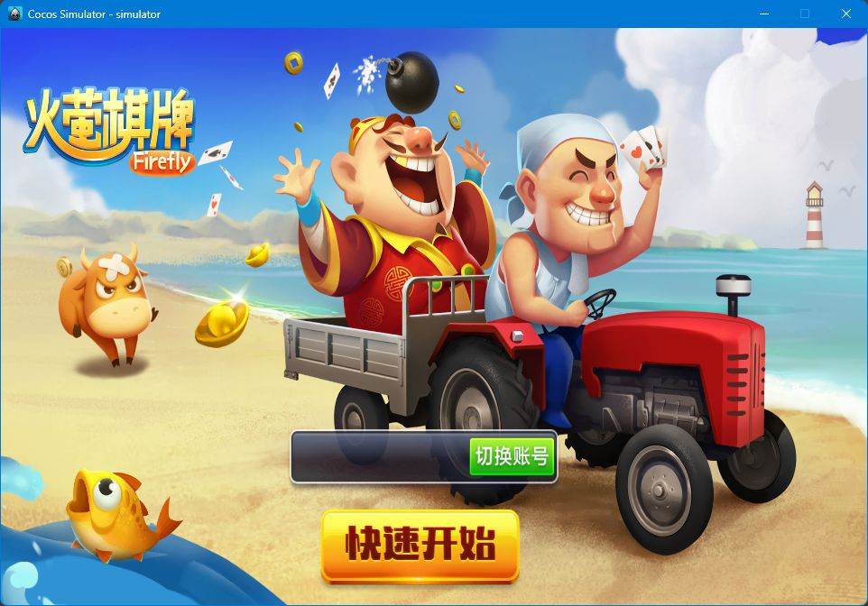
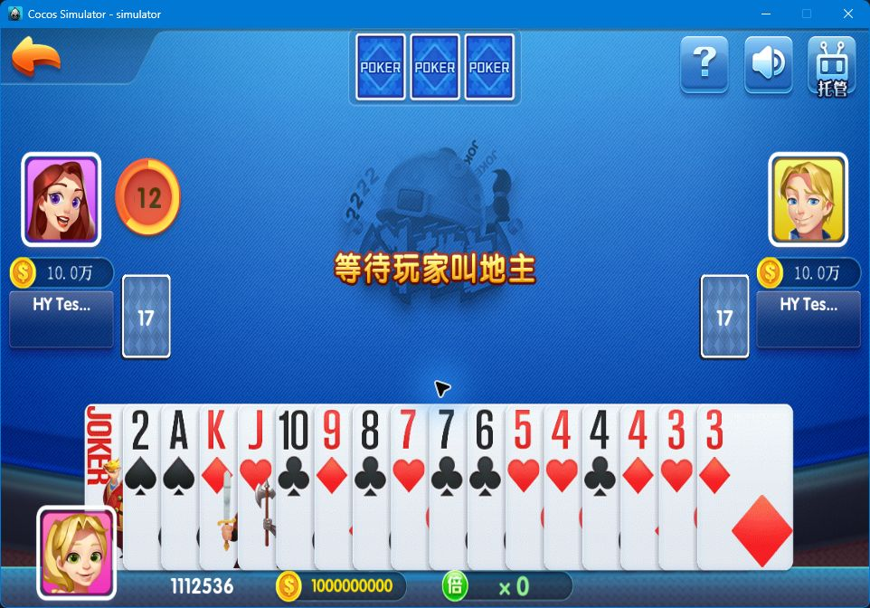
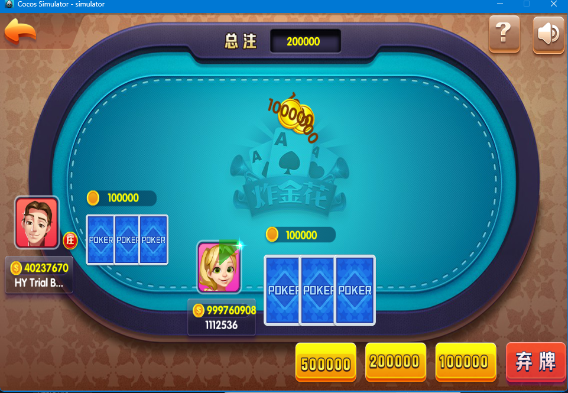
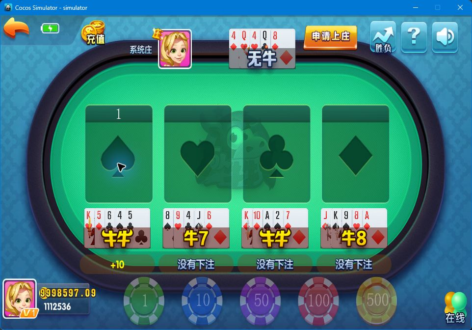
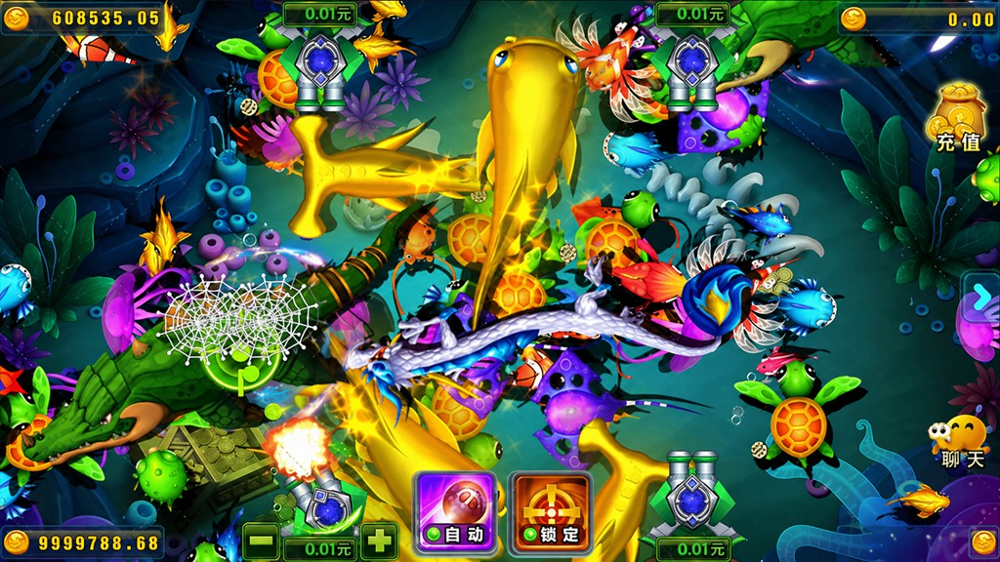
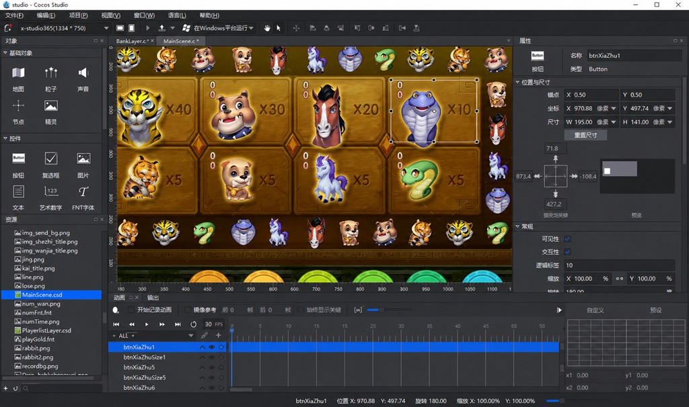
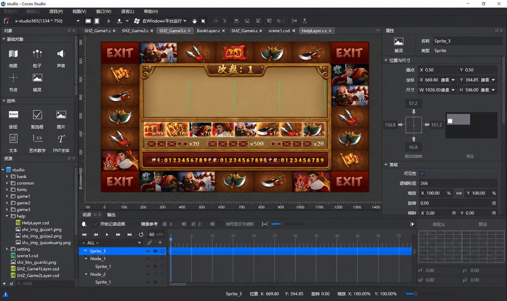
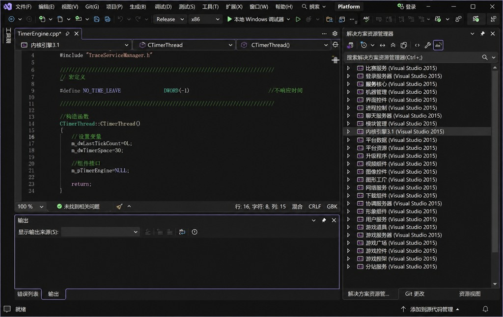

# 🎮 新火萤｜棋牌游戏与源码展示

**从统一大厅到多款游戏场景，涵盖棋牌、麻将、捕鱼与主题休闲玩法。**

|  |  |  |  |  |
| :---: | :---: | :---: | :---: | :---: |

[📸 看游戏画面](#-游戏画面) · [🎲 看游戏一览](#-游戏一览) · [📂 看源码工程](#-源码工程) · [🗂️ 完整目录](GAME_SOURCE_CATALOG.md)



新火萤围绕大厅、游戏房间和牌桌场景组织游戏体验。经典棋牌与主题场景采用不同的界面设计，配有玩家席位、牌面、筹码、动画及相应操作区域。

| 🃏 棋牌与麻将 | 🐟 捕鱼与休闲 | 🛠️ 源码与工程 |
| :---: | :---: | :---: |
| 经典牌桌 · 多种玩法 | 水下场景 · 主题设计 | 客户端 · 服务端 · 界面资源 |

---

## 📸 游戏画面

以下选用项目现有界面素材、测试截图与开发工程画面，展示不同版本的视觉风格。游戏截图中的测试昵称、积分与筹码用于界面展示。

### 🃏 经典牌桌 · 斗地主与诈金花

| 斗地主 | 诈金花 |
| :---: | :---: |
|  |  |
| 三人牌桌布局，手牌集中展示，叫牌、出牌与托管操作围绕牌局展开。 | 环形牌桌、玩家头像与手牌区域，配合筹码和跟注、弃牌等操作，呈现经典三张牌玩法。 |

### 🐂 百人牛牛

分区牌面、庄家信息和筹码区域在同一画面中展示，突出多区域桌面游戏的视觉布局。



### 🐟 捕鱼

水下场景搭配鱼群、炮台、鱼网和动态特效，呈现丰富的捕鱼主题画面。



### 🎨 飞禽走兽与水浒传主题

动物图案、主题角色、转轮与筹码元素组成不同风格的休闲场景。下图为 Cocos Studio 中的界面工程，展示可编辑的节点与布局。

| 飞禽走兽主题界面工程 | 水浒传主题界面工程 |
| --- | --- |
|  |  |

---

## 🎲 游戏一览

源码目录已核对：服务端 47 个顶层目录按游戏编号归为 28 类；展开的客户端包含 63 个协议模块目录。两侧合计 52 个编号组，其中存在同编号不同主题及同玩法多版本，故不将编号数直接写成独立游戏总数。统计包含所有已识别源码，不按当前运行情况筛选。

> 📂 **[查看完整源码目录索引 →](GAME_SOURCE_CATALOG.md)**  
> 按编号查找客户端、服务端、二开副本与归档源码。下表为分类速览。

| 游戏类别 | 代表性模块 |
| --- | --- |
| 🃏 经典棋牌 | 斗地主、诈金花、跑得快、十三水、510K、德州扑克、五人21点 |
| 🐂 牛牛与桌面游戏 | 抢庄牛牛、百人牛牛、百家乐、龙虎斗、红黑大战 |
| 🀄 麻将 | 二人红中麻将、血战麻将 |
| 🐟 捕鱼系列 | 鳄鱼捕鱼、千炮捕鱼、新李逵劈鱼、新金蝉捕鱼、新摇钱树 |
| 🎡 主题休闲 | 飞禽走兽、奔驰宝马、财神到、水浒传、水果拉霸、连环夺宝 |

---

## 📂 源码工程

项目按客户端、平台服务、子游戏、Web 和界面资源组织。下面为源码项目内的相对目录，便于了解工程结构。

```text
HY/
├── client/
│   ├── client/
│   │   ├── client/          大厅相关代码
│   │   └── game/            Lua 游戏模块
│   └── frameworks/          客户端引擎与平台工程
├── Server/
│   └── 子游戏/              游戏服务与相关组件
├── WebCode/                 Web 前台与管理后台
├── DB/                      数据库相关文件
├── UI/                      界面与资源工程
└── UI_Game/                 子游戏界面工程
```

### 🗂️ 代表性游戏源码路径

| 游戏 | 客户端模块 | 服务端目录 |
| --- | --- | --- |
| 斗地主 | `client/client/game/qipai/landhy/` | `Server/子游戏/斗地主/` |
| 诈金花 | `client/client/game/yule/zhajinhuahy/` | `Server/子游戏/诈金花/` |
| 百人牛牛 | `client/client/game/yule/oxbattlehy/` | `Server/子游戏/百人牛牛/` |
| 飞禽走兽 | `client/client/game/yule/animalbattlefqzs/` | `Server/子游戏/飞禽走兽/` |
| 奔驰宝马 | `client/client/game/yule/animalbattlebcbm/` | `Server/子游戏/碰碰车/` |
| 红中二人麻将 | `client/client/game/yule/sparrowhztwo/` | `Server/子游戏/红中麻将_二人/` |
| 湖南跑得快 | `client/client/game/yule/runfasthn/` | `Server/子游戏/湖南跑得快/` |

游戏展示名称与历史工程目录名可能不同，例如奔驰宝马对应的服务端工程位于“碰碰车”目录。以上路径用于展示源码组织方式，不是公开下载链接。

### 🤖 游戏逻辑、机器人与消息定义

以斗地主工程为例，服务逻辑、机器人与通信消息分别组织：

```text
Server/子游戏/斗地主/
├── 服务器组件/
├── 服务器控制/
├── 机器人服务/
├── 消息定义/
└── 客户端 D3D/
```

### 💻 服务端开发工程画面

项目现有的 Visual Studio 工程截图展示平台组件、源码编辑区与解决方案结构。



### 🛠️ 技术组成

| 部分 | 主要技术 |
| --- | --- |
| 游戏客户端 | Cocos2d-x、Lua |
| 平台及游戏服务 | C++、Visual Studio |
| Web 前台与后台 | C#、.NET Framework |
| 数据库 | SQL Server |
| 界面与场景编辑 | Cocos Studio |

---

[📸 返回游戏画面](#-游戏画面) · [🗂️ 浏览完整源码目录](GAME_SOURCE_CATALOG.md)

本页用于游戏与源码工程展示。


